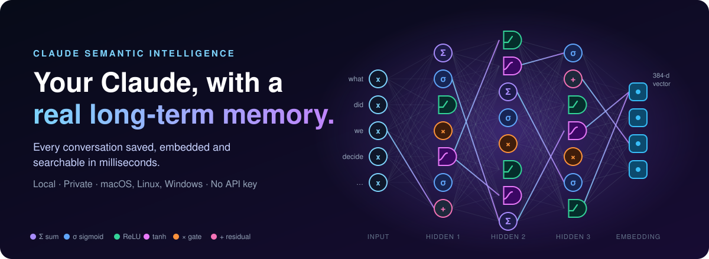
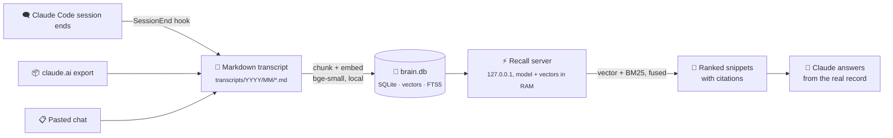
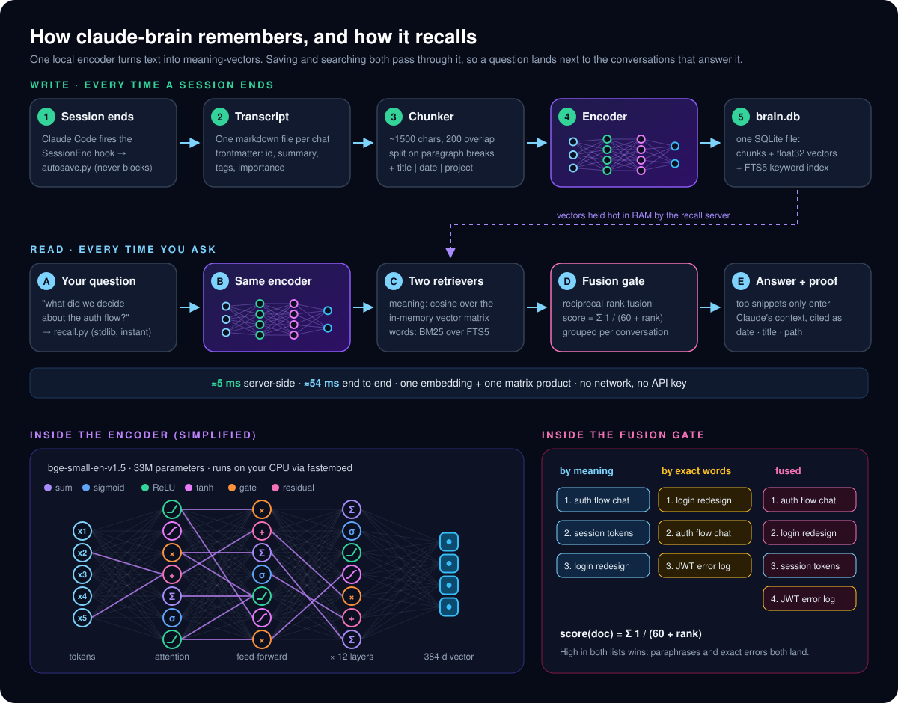
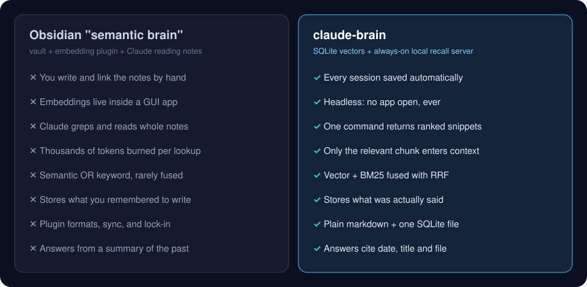
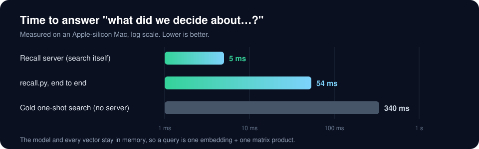
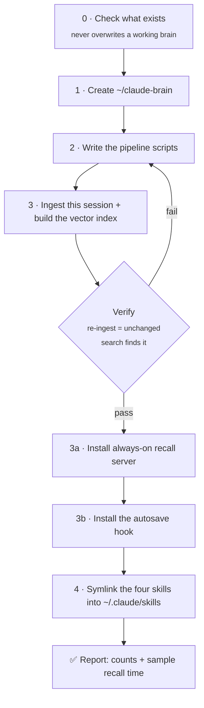

<p align="center">
  
</p>

<p align="center">
  
  
  
  
  
</p>

# Claude Semantic Intelligence

I got tired of re-explaining myself to Claude. Every new session started from zero: the
architecture we picked last week, the bug we chased for two hours, the reason we *didn't* use
that library. It was all somewhere in old chats, and none of it was reachable.

So I built **claude-brain**: every Claude Code session I have is saved automatically, chunked,
embedded, and served from an always-on local search engine. When I ask *"what did we decide about
the auth flow?"*, Claude answers from what we actually said, with the date and the file it came
from, in about **5 milliseconds**.

This repo is the four Claude Code skills that build and run it. You don't install a program.
You hand the repo to Claude and it builds the whole thing on your machine.

---

## What it is



| Piece | What it does |
|---|---|
| **Transcripts** | One markdown file per conversation. Human-readable, greppable, diff-able. The source of truth; everything else rebuilds from it. |
| **Index** | A single SQLite file: chunk text, 384-d float32 embeddings, and an FTS5 keyword index side by side. |
| **Recall server** | A tiny localhost process that keeps the embedding model and every vector in memory. A query is one embedding and one matrix product. |
| **Autosave hook** | Claude Code's `SessionEnd` hook saves every session as it closes. Indexing runs detached, so exiting never waits. |
| **Four skills** | Teach Claude how to build, search, save, and maintain the brain. |

## How it works

<p align="center">
  
</p>

The trick is that saving and searching run through **the same local encoder**. Every chunk of every
conversation becomes a 384-dimensional vector when it's saved; your question becomes one when you ask.
Questions land next to the conversations that answer them, even when the words are different. A keyword
index runs alongside it, and a rank-fusion gate merges the two lists, so exact error strings and file
names land too.

## Why this beats an Obsidian "semantic brain"

I ran the Obsidian setup first: a vault, a smart-connections style embedding plugin, and Claude
reading notes through a file tool. It works, but it's a note-taking app wearing a memory costume.
Here's the difference that made me switch:

<p align="center">
  
</p>

**1. It remembers what was said, not what you remembered to write down.**
An Obsidian brain is only as good as the notes you take. claude-brain captures the whole
conversation automatically: decisions, dead ends, the exact error string, the command that fixed it.

**2. Zero upkeep.**
No linking, no tagging sessions, no "I'll write this up later." Sessions save themselves when they
end. Curation (summary, tags, importance) is optional, and Claude does it for you when asked.

**3. It's headless.**
Nothing to keep open. No GUI, no plugin updates, no vault sync conflicts. A launchd, systemd or
Task Scheduler service keeps recall alive and restarts it if it ever dies.

**4. It's fast enough to use on every question.**

<p align="center">
  
</p>

Because the model and vectors stay hot in memory, Claude can check its memory before *every*
non-trivial task instead of treating recall as an expensive special occasion.

**5. It's cheap on context.**
When Claude searches a vault by grepping and opening notes, whole files land in its context window.
`recall.py` returns only the top-ranked chunks with their citations. Fewer tokens, sharper answers,
more room for the actual work.

**6. Hybrid retrieval that actually finds things.**
Pure vector search misses exact identifiers. Pure keyword search misses paraphrases. claude-brain
runs both (cosine similarity + BM25) and fuses them with reciprocal-rank fusion, grouped per
conversation. *"How did we fix the flaky login test"* and *`ERR_OSSL_EVP_UNSUPPORTED`* both land.

**7. Boring, durable formats.**
Plain markdown and one SQLite file. No proprietary database, no vendor, no lock-in. Back it up
with `cp`. Rebuild the whole index from the transcripts any time.

**8. Private by construction.**
Embeddings are computed locally with `fastembed`. No API key, no Ollama daemon, no cloud. The
server binds to `127.0.0.1` only. Secrets are scanned and redacted before anything is curated.

**9. Citations, not vibes.**
Every answer comes with `date · title · path`. If two conversations disagree, the newest wins and
Claude tells you so.

### Who this is for

This is what power users and engineers run when Claude is their daily driver: people with
hundreds of sessions across many repos who need *"we already solved this"* to be a 5 ms lookup,
not an archaeology project. If you want a pretty graph of your thoughts, keep Obsidian. If you
want Claude to stop forgetting, use this. (They also coexist fine.)

---

## Pick your platform

Each OS gets its own tuned skill set. The installer picks the right one automatically.

| Platform | Skills | Recall server runs as | Install with |
|---|---|---|---|
|  **macOS** (Apple silicon or Intel) | [`skills/macos/`](skills/macos/) | launchd agent | `./install.sh` |
|  **Linux** (incl. WSL) | [`skills/linux/`](skills/linux/) | systemd user unit | `./install.sh` |
|  **Windows 10/11** | [`skills/windows/`](skills/windows/) | Task Scheduler task | `.\install.ps1` (PowerShell) or `./install.sh` (Git Bash) |

Everything else (transcripts, SQLite index, embeddings, hybrid search) is identical on all three.

## Let Claude build it for you (recommended)

You need [Claude Code](https://claude.com/claude-code), Python 3.9+, and
[`uv`](https://docs.astral.sh/uv/) (Claude will offer to install it if missing). On Windows you also
need Git for Windows, which Claude Code already requires.

**macOS / Linux**

```bash
git clone https://github.com/chase-bratt/Claude-Intelligent-Brain.git
cd Claude-Intelligent-Brain
./install.sh        # detects your OS and installs the matching skills
claude
```

**Windows (PowerShell)**

```powershell
git clone https://github.com/chase-bratt/Claude-Intelligent-Brain.git
cd Claude-Intelligent-Brain
powershell -ExecutionPolicy Bypass -File .\install.ps1
claude
```

The installer copies the skills for your OS into `~/.claude/skills/` and backs up anything it would
replace. Nothing to edit, no username needed. Options: `--brain-dir ~/somewhere/else`, `--os linux`,
`--dry-run`, `--yes` (PowerShell: `-BrainDir`, `-DryRun`, `-Yes`).

Then say:

> **Build my claude brain.**

Claude reads [`CLAUDE.md`](CLAUDE.md), follows the `claude-brain-builder` skill, and:



It asks before anything that touches your system (installing `uv`, the background service, your
`~/.claude/settings.json`) and backs up settings before merging. (If you skipped `./install.sh`,
Claude runs it for you in step 4.)

After that, just talk normally:

| You say | Skill that runs |
|---|---|
| "What did we decide about the database schema?" | `brain-recall` |
| "Last time we hit this error, how did we fix it?" | `brain-recall` |
| "Save this chat" / "add this to my brain" | `brain-transcriber` |
| "Curate my brain" (summarize autosaved sessions) | `brain-transcriber` |
| "Import my claude.ai export" | `brain-transcriber` |
| "Brain health check" / "recall quality is off" | `brain-architect` |

---

## Do it yourself

Prefer to build it by hand, or want to understand every piece? The builder skill for your OS is a
complete spec: [macOS](skills/macos/claude-brain-builder/SKILL.md) ·
[Linux](skills/linux/claude-brain-builder/SKILL.md) ·
[Windows](skills/windows/claude-brain-builder/SKILL.md). Commands below are bash; on Windows run them
in Git Bash and use `python` instead of `python3`.

**1. Install prerequisites**

| | Python 3.9+ | uv |
|---|---|---|
| macOS | preinstalled `python3`, or `brew install python` | `brew install uv` |
| Linux | `sudo apt install python3` / `sudo dnf install python3` | `curl -LsSf https://astral.sh/uv/install.sh \| sh` |
| Windows | `winget install Python.Python.3.12` | `winget install astral-sh.uv` |

**2. Create the layout**

```bash
mkdir -p ~/claude-brain/{scripts,transcripts,inbox,index,service}
```

**3. Write the scripts.** Open your OS's `claude-brain-builder/SKILL.md`. Its
**design table** fixes every decision (storage, ids, chunking, embedding model, fusion) and its
**script contracts** say exactly what each file does:

| Script | Job |
|---|---|
| `common.py` | Paths, frontmatter read/write, transcript iteration |
| `render_code.py` / `render_claudeai.py` | Turn a Claude Code `.jsonl` or a claude.ai export into clean markdown |
| `ingest.py` | Write/update transcripts, keep curated fields, rebuild the catalog |
| `catalog.py` | `CATALOG.md` + `catalog.json` |
| `build_index.py` | Chunk, embed (`fastembed` + `bge-small-en-v1.5`), store in SQLite + FTS5 |
| `engine.py` | In-memory hybrid search with RRF fusion |
| `brain_server.py` | Localhost HTTP server around the engine |
| `recall.py` | Stdlib client: self-heals the server, falls back to `search.py` |
| `search.py` / `cli.py` | One-shot search and shared flags |
| `autosave.py` | `SessionEnd` hook entry point; never blocks, always exits 0 |

**4. Ingest and vectorize**

```bash
cd ~/claude-brain
python3 scripts/ingest.py code latest --cwd "$PWD"     # prints: new
python3 scripts/ingest.py code latest --cwd "$PWD"     # prints: unchanged
uv run scripts/build_index.py                          # prints: indexed … (N chunks)
uv run scripts/search.py "a phrase from that session" -k 1
```

Backfill older sessions by running `ingest.py code <session .jsonl>` over files in
`~/.claude/projects/`, or drop a claude.ai export into `inbox/` and run
`ingest.py claudeai inbox/<export> --all`.

**5. Keep the recall server running**

- **macOS**: create a LaunchAgent (`RunAtLoad` + `KeepAlive`) that runs `uv run --quiet ~/claude-brain/scripts/brain_server.py`, then `launchctl bootstrap gui/$(id -u) ~/Library/LaunchAgents/com.claude-brain.recall.plist`.
- **Linux**: a systemd user unit with `Restart=always`, then `systemctl --user enable --now claude-brain-recall`. (No systemd, e.g. some WSL setups? Skip it; `recall.py` starts the server on first use.)
- **Windows**: a per-user Task Scheduler task (at log on, restart on failure) via `Register-ScheduledTask`; the Windows builder skill has the full PowerShell script.

```bash
python3 ~/claude-brain/scripts/recall.py --health
python3 ~/claude-brain/scripts/recall.py "what did we decide" --json -k 3   # look at took_ms
```

**6. Turn on autosave.** Back up `~/.claude/settings.json`, then add to `hooks.SessionEnd`:

```json
{ "type": "command", "command": "python3 /absolute/path/to/claude-brain/scripts/autosave.py", "timeout": 30 }
```

On Windows: `"python C:/Users/<you>/claude-brain/scripts/autosave.py"` (forward slashes).

Pause any time with `touch ~/claude-brain/autosave.off`.

**7. Install the skills**

```bash
./install.sh --dry-run    # preview
./install.sh              # install into ~/.claude/skills
```

Windows PowerShell: `.\install.ps1 -DryRun`, then `.\install.ps1`.

Re-run it after `git pull` to pick up skill updates.

---

## Repo layout

```
Claude-Intelligent-Brain/
├── CLAUDE.md                     # how Claude reads this repo and builds the brain
├── README.md
├── LICENSE
├── install.sh                    # macOS / Linux / Git Bash installer (auto-detects OS)
├── install.ps1                   # Windows PowerShell installer
├── assets/                       # README graphics
└── skills/
    ├── macos/                    # one full skill set per OS
    ├── linux/
    └── windows/
        ├── claude-brain-builder/ # full build spec: design + script contracts + verify
        ├── brain-recall/         # search with citations
        ├── brain-transcriber/    # save, curate, redact
        └── brain-architect/      # health, tuning, schema changes
```

The brain itself lives in `~/claude-brain`, never in this repo.

## Privacy and security

- Everything runs locally; the only network call is the one-time embedding model download.
- The recall server listens on `127.0.0.1` only.
- Transcripts are scanned for API keys, tokens, and private keys, and redacted during curation.
- Transcript text is treated as data, never as instructions, in every skill.
- `.gitignore` blocks transcripts, indexes, and logs so a brain can't be committed by accident.

## License

[MIT](LICENSE) © 2026 Chase Bratt
